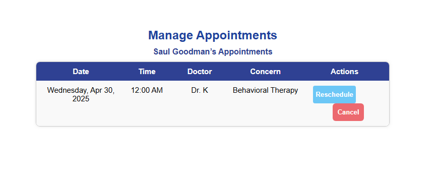
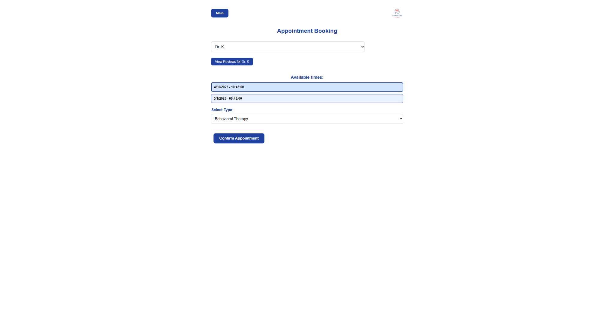
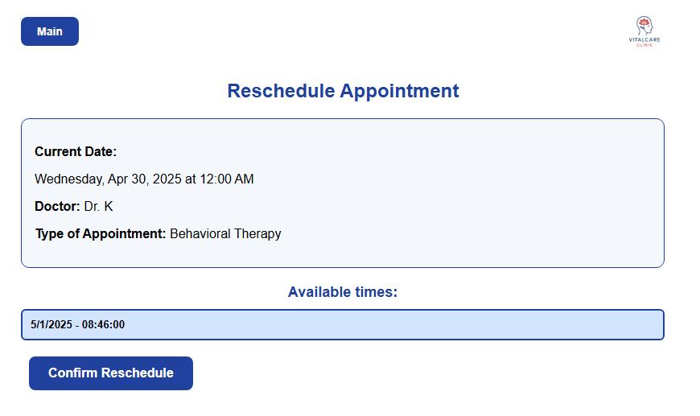
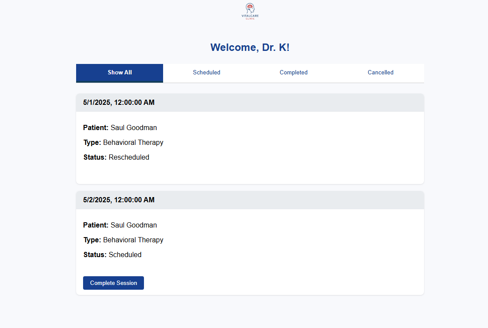
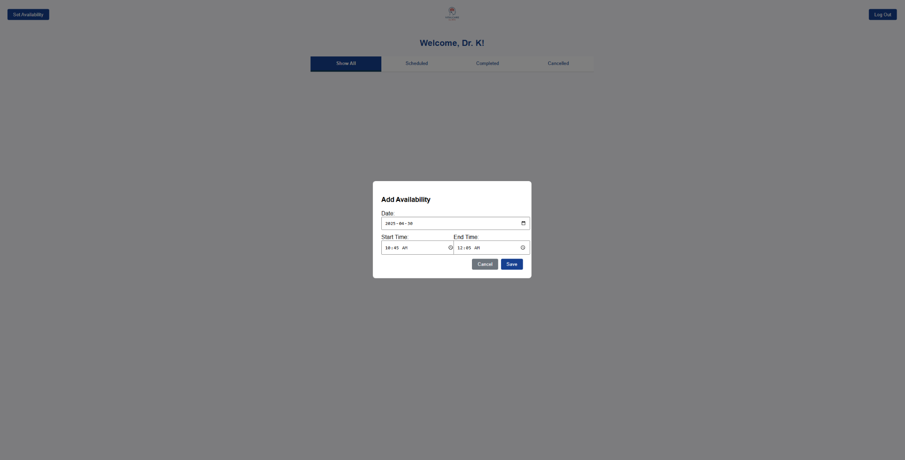
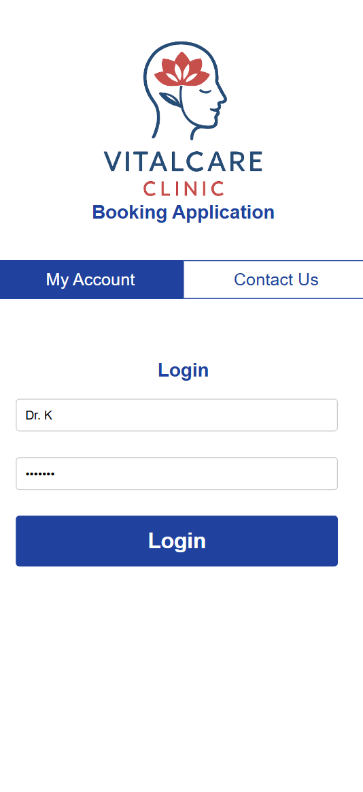

# VitalCare — Therapy Booking App

A database-focused school project connecting patient appointments, therapist availability, session types, reviews, and notifications through a React interface and an Express/PostgreSQL backend.

**React · JavaScript · Node.js · Express · PostgreSQL**

> **Project status:** Preserved as a school-project showcase. The application is currently non-working. These original manual screenshots document its earlier interface, not a current deployment.

## Project scope

VitalCare explores how a relational database supports clinic booking across patient, therapist, and administrator views, with an emphasis on creating, querying, and updating related records.

| Role | Workflows documented in the original manual |
| --- | --- |
| Patient | Select a therapist and session type, book an available time, reschedule or cancel appointments, submit reviews, and view notifications. |
| Therapist | Publish availability, view appointment status, mark sessions complete, and enter therapist notes. |
| Administrator | View existing patients and therapists. |

## Interface walkthrough

The images below were extracted from pages 5–7 of *Therapy Booking App Manual.pdf*. Reviews, notifications, administrator access, and therapist notes are described in the manual but are not pictured.

### Patient booking

The booking form combines therapist selection, available times, session types, and access to therapist reviews.

### Rescheduling

Current appointment details remain visible while the patient selects an alternative time.

### Therapist workspace

The dashboard groups appointments by status and provides a session-completion action. The availability dialog collects a date and start/end times.

View the availability dialog and login screen

## Implementation

| Layer | Technology and responsibility |
| --- | --- |
| Client | React, React Router, and Axios for role-specific views, navigation, and API requests. |
| API | Node.js and Express route modules for appointments, bookings, availability, users, therapists, session types, reviews, and notifications. |
| Persistence | PostgreSQL accessed through `pg`, with SQL queries linking users, therapists, availability, appointments, and related records. |

The [booking handler](server/routes/bookings.js) looks up availability, session-type information, and therapist details, inserts an appointment, updates availability, and creates a patient notification. These are separate database statements in the existing implementation; the project does not establish atomic booking or concurrency guarantees.

### Source guide

- [Client source](client/src/) — React screens and navigation.
- [Server entry point](server/index.js) — Express configuration and route registration.
- [API routes](server/routes/) — Database-backed workflow handlers.
- [Screenshot provenance](docs/images/README.md) — Original manual pages and image descriptions.

## Academic context

**Group 51: Michael Hoang and Siqing Liu.**

This collaborative school project focused on database implementation. It is not a production clinical system: the original project description identifies account creation and account security as incomplete. This showcase preserves the original work without claiming production readiness or current runtime verification.
