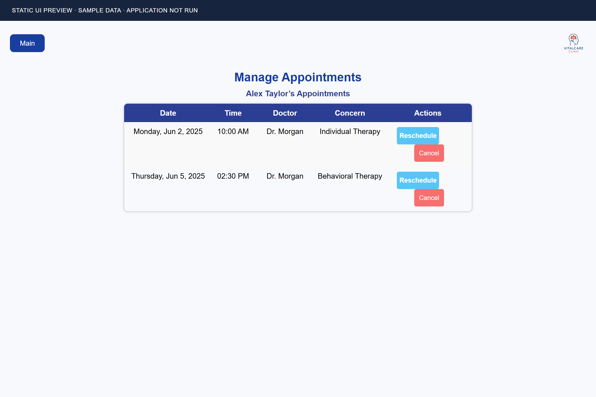
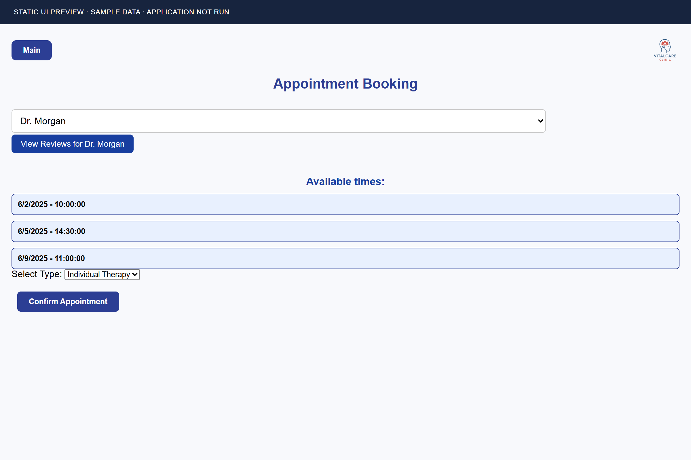
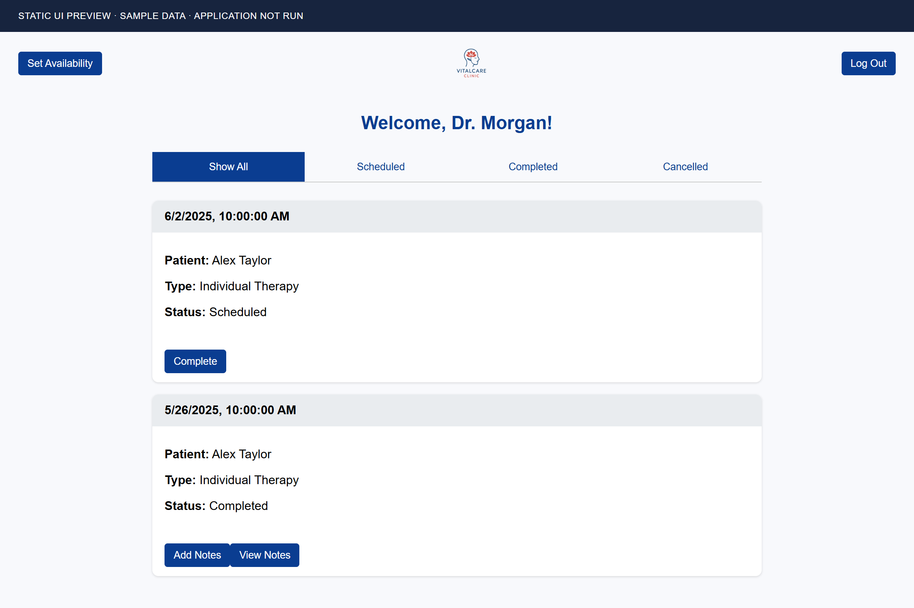

# VitalCare — Therapy Booking App

A collaborative school project exploring database-backed therapy scheduling through patient, therapist, and administrator workflows.

**React · JavaScript · Node.js · Express · PostgreSQL**

## Project status

This repository contains the updated source supplied by the project author as the working version. The app was not launched, and the PostgreSQL database was not configured or tested during this update.

The images here are **static UI previews reconstructed from the supplied components and styles with fictional sample data**. They illustrate the interface without running React, the API, or the database. Each image is labeled accordingly.

## Workflows

| Role | Features represented in the source |
| --- | --- |
| Patient | Browse therapists and availability, select session types, book appointments, reschedule or cancel, submit reviews, and view notifications. |
| Therapist | Set availability, filter appointments by status, complete sessions, and add or view session notes. |
| Administrator | View patient and therapist records. |

## Interface previews

### Book an appointment

Therapist selection, available times, session types, and booking confirmation in one flow.

### Manage therapist sessions

Status filters separate scheduled, completed, and cancelled appointments. Completed sessions provide note-management actions.

[Preview methodology and reproducible HTML](docs/previews/README.md) · [Historical manual screenshots](docs/images/README.md)

## Implementation

| Layer | Responsibility |
| --- | --- |
| React client | Role-specific screens, React Router navigation, and Axios API requests. |
| Express API | Route modules for authentication, appointments, availability, session notes, reviews, notifications, and user records. |
| PostgreSQL | Relational storage accessed through `pg` and parameterized SQL queries. |

The [booking handler](server/routes/bookings.js) retrieves therapist and session information, inserts an appointment, updates availability, and creates a notification. These operations are separate statements in the supplied implementation; atomic booking and concurrency guarantees have not been established.

## Source guide

- [Client screens](client/src/Pages/) and [styles](client/src/Styles/).
- [API entry point](server/index.js) and [route handlers](server/routes/).
- [Session-note routes](server/routes/sessionNotes.js).
- [Environment template](server/.env.example) with placeholder credentials.
- [ZIP import record](docs/source-import.json).

The source was imported from `therapy-booking-app.zip`. Bundled `node_modules` folders and the private `.env` file are excluded; dependencies remain specified in the package manifests and lockfiles. Database provisioning is outside this documentation update. No verified installation or deployment claim is made here.

## Academic context

**Group 51: Michael Hoang and Siqing Liu.**

This project focuses on relational data and application workflows. It is a school project, not a production clinical system. Its authentication and data-handling implementation should not be treated as production-ready security.
